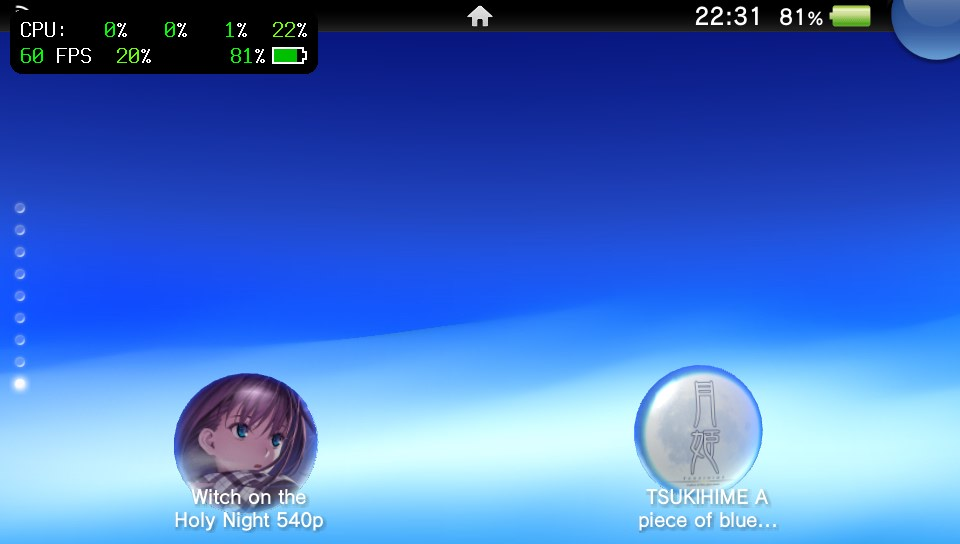
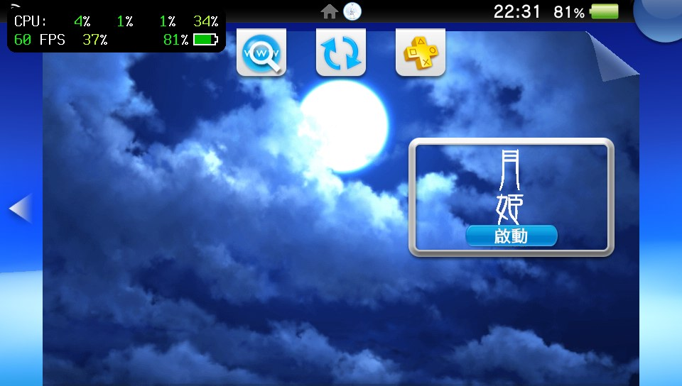
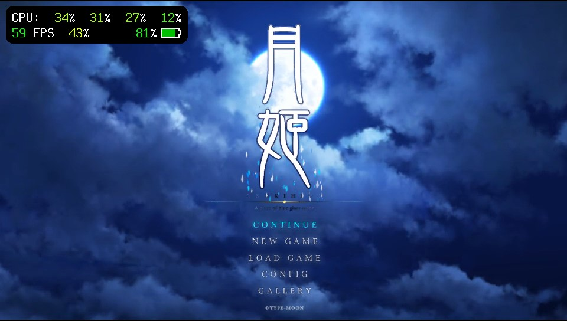
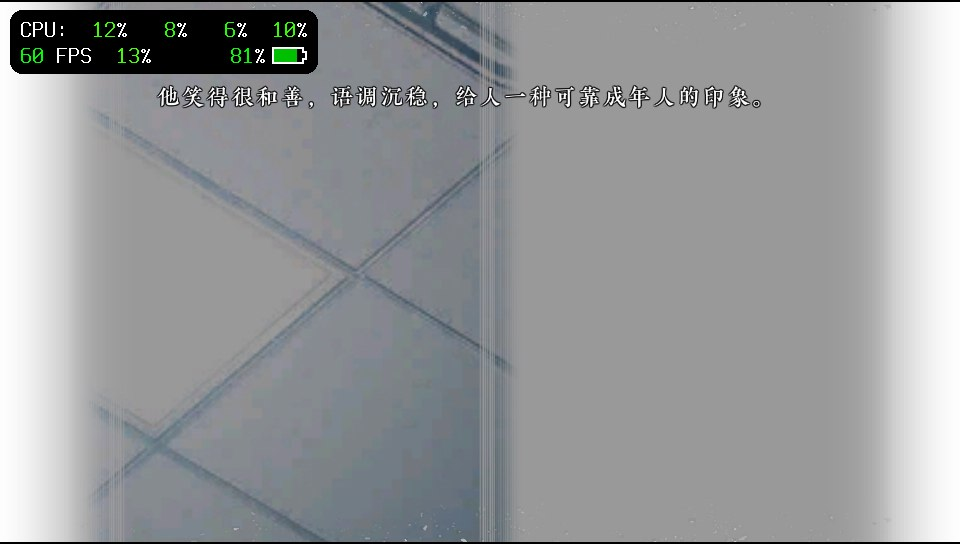

# tsik-vita · Tsukihime for PS Vita

[简体中文](README.md) | **English**

A **PlayStation Vita / PS TV** engine port of *Tsukihime -A piece of blue glass moon-*, based on [AuroraWright/knife](https://github.com/AuroraWright/knife) 0.9.4 and the Vita work in [mofa-vita](https://github.com/ATSPwang618/mofa-vita). It uses Rust game logic and a native GXM renderer targeting **32-bit ARMv7**.

The scene and composite canvas is **960×540**, displayed on a **960×544** screen. The current build combines the stable asset pack with fully offline shaders. **Implemented optimizations are enabled by default; no TXT switch files are required.** Individual paths still depend on memory budgets, draw conditions and driver support.

> This source repository does not include game data, original fonts or a VPK. Supply legally obtained, matching assets. ARM builds and scoped host tests have passed; the current build has not completed a full device playthrough or GPU performance measurement.

## Screenshots

Player-provided PS Vita screenshots from October 31, 2026. They predate the current offline-shader build; overlay FPS values only describe the captured scenes.

| Home screen bubble | LiveArea |
| --- | --- |
|  |  |

| Title screen | Simplified Chinese story |
| --- | --- |
|  |  |

## Features

- **Two languages:** Simplified Chinese and Japanese, retaining original language IDs 2 / 0. New configurations default to Simplified Chinese. Dynamic text shares the selected font and supplementary glyphs.
- **Game systems:** story, choices, settings, save/load, quick save/load, auto advance, skip, backlog, CG Gallery, Music Player, Flowchart, Movie and Ending List. Gallery content follows progress unlocks.
- **Vita controls:** buttons, both sticks, front touch, native audio and movies. A maps to ○; B maps to ×.
- **Opening credits:** the corrected @Zarathustra / @lisen image appears first, with fade-in, hold and fade-out totaling approximately eight seconds.
- **Unified storage:** assets, saves, configuration and resource-error records live under `ux0:data/TSUKIHIME-RE/`. VitaDeck / CatLog console output is supported.

## Implemented optimizations

| Area | Current implementation |
| --- | --- |
| Offline effects | 109 embedded GXM programs, including 63 state-specific variants; no runtime shader compiler or disk shader cache |
| Pixel work | Specialized image, text, blur and 24 blend-operation paths remove unnecessary branches while retaining generic fallbacks |
| Story memory | All 23,177 story image entries audited; 15,901 downsampled; worst-case RGBA storage including row pitch capped at 512 KiB per selected image |
| Lossless upload storage | Eligible immutable RGBA images use exact P8 palettes or RGB24, including transparent and semitransparent palettes; native GXT remains compressed |
| Scheduling | Render output reuse, segmented text caches, asynchronous cohort preparation, sound preparation, a persistent movie owner thread and bounded caches |
| Stable budgets | Text and group caches capped at 4 MiB each; optional target rotation and static-prefix budgets set to zero; optional ownership released before image changes |
| UI and I/O fixes | Wide/tall UI atlas admission, music fonts, CG loading and paged thumbnails; SDK large-file I/O while keeping the executable ARM32 |

**Story image downsampling sacrifices detail.** UI, fonts and paged CG thumbnails are not uniformly reduced with story images. P8 / RGB24 upload preserves its input pixels; this does not make the entire asset pipeline lossless. The [optimization catalog](doc/optimizations.md) documents all 29 switches, boundaries and supporting evidence in Chinese.

## Installation

1. Exit the game completely and install the local `release/knife-vita-tsukihime-540p.vpk` with VitaShell.
2. Copy the matching `dist/TSUKIHIME-RE/assets/` tree to `ux0:data/TSUKIHIME-RE/assets/` without adding an extra directory level.
3. Start the game. It defaults to Simplified Chinese; select and save Japanese in settings if desired.

~~~text
ux0:data/TSUKIHIME-RE/
├── assets/                 # Matching converted assets
├── saves/                  # Saves, configuration and progress
└── resource-error.json     # Written on resource-loading failures
~~~

The asset source is the **overseas Switch base + update v1.0.1**, program build ID `d10d239aade1d526`. An original NSP or romfs is not a drop-in replacement for converted Vita assets. Normal play requires no optimization or logging switch files. See the [asset guide](doc/assets.md) for compatibility and conversion details.

## Controls

| Vita input | Common action |
| --- | --- |
| ○ / A | Confirm / advance; restore the message window first if hidden |
| × / B | Cancel / back; stop story skipping first, otherwise toggle the message window |
| □ / X | Toggle backlog |
| △ / Y | Toggle the system menu |
| L / R | Story auto advance / skip; page-specific menu actions |
| D-pad / right stick | Menu navigation; D-pad up opens the story mode panel |
| Left stick | Scroll lists, CG and flowchart; ±16 center deadzone |
| Front touch | Tap and drag; tap the story's top area for the mode panel |
| START | Skip a movie in Movie mode |
| SELECT | Toggle aspect-preserving fill in the CG viewer; some edges are cropped |

Use **Q.SAVE / Q.LOAD** in the story mode panel or system menu. Availability follows script save permissions and whether a quick save exists.

## Logs and troubleshooting

Console logging is enabled by default. Start the VitaDeck log receiver before launching the game, using a working CatLog setup. FTP transfers and real-time logs use separate channels. Use **TITLE ID `KNIF00541`** when launching from VitaDeck.

For failures, retain the filename, story position, language, screenshot and resource-error record. Do not bypass checks by editing the asset manifest. See [troubleshooting](doc/troubleshooting.md) and [logging / memory budgets](doc/performance.md).

## Current delivery and validation

| Item | Value |
| --- | --- |
| Build tag | `tsukihime540-offline-shaders-20261106` |
| VPK size | 5,385,822 bytes, approximately 5.14 MiB |
| TITLE ID / APP_VER | `KNIF00541` / `00.01` |
| Target | `armv7-sony-vita-newlibeabihf`, ELF32 ARM |
| Assets | 16,764 data files plus manifest, approximately 2.26 GiB |
| Latest shader checks | 4 Python tests; 28 native routing cases / 6,287 checks; 877 input cases / 2,631 checks |
| Renderer scope | 127 default-configuration tests pass; the stable pressure fixture passes; the full stable configuration still has 5 budget-assumption failures and is not reported as fully passing |

Package and asset hashes, dated test results and pending hardware checks are centralized in [validation](doc/validation.md). The November 6, 2026 repository cleanup changes neither the game executable nor its assets and does not rebuild the VPK or publish a Release.

## Development and documentation

Run from the repository root:

~~~sh
python3 tools/build-vita.py --check
python3 tools/build-vita.py --variant tsukihime540 game release
python3 tools/check-vita-package.py release/knife-vita-tsukihime-540p.vpk KNIF00541 --release
~~~

On Windows, use `py -3` or `tools/build-vita.ps1 -Variant tsukihime540`. Toolchain requirements, offline mode and generated inputs are documented in the [build guide](doc/build.md).

| Guide | Contents |
| --- | --- |
| [Documentation index](doc/README.md) | Technical guide navigation; detailed guides are currently in Chinese |
| [Optimization catalog](doc/optimizations.md) | All 29 switches, additional optimizations, fixes and limitations |
| [Architecture](doc/architecture.md) / [Assets](doc/assets.md) | Resource, coordinate, threading and conversion contracts |
| [Performance](doc/performance.md) / [Shaders](doc/shaders.md) | Defaults, budgets, offline programs and developer A/B procedures |
| [Validation](doc/validation.md) / [Troubleshooting](doc/troubleshooting.md) | Reproducible evidence and outstanding device checks |
| [Maintenance](doc/maintenance.md) / [Tools](tools/README.md) | Directory responsibilities, cleanup and dependencies |

Keep one `dist/` asset tree and the final VPK. Run `python3 tools/clean-project.py` to preview disposable caches; add `--apply` to remove the listed paths. Changes remain local unless the user explicitly requests a push.

## Credits and license

Thanks to **@Zarathustra**, **@lisen**, **AuroraWright / knife**, **mofa-vita**, and everyone contributing device tests, screenshots and feedback.

The engine retains the [MPL 2.0](knife/LICENSE); see [UPSTREAM.txt](knife/UPSTREAM.txt) for provenance. Native dependency licenses remain in `knife/vita/vendor/`. Game data, artwork, audio/video, fonts and translations belong to their respective rights holders.
