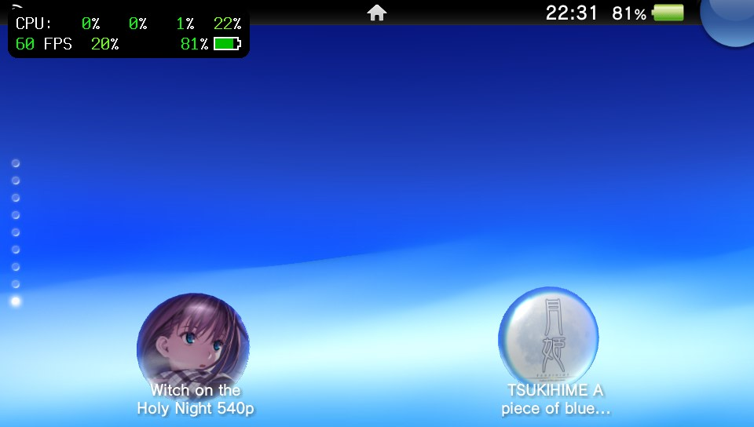
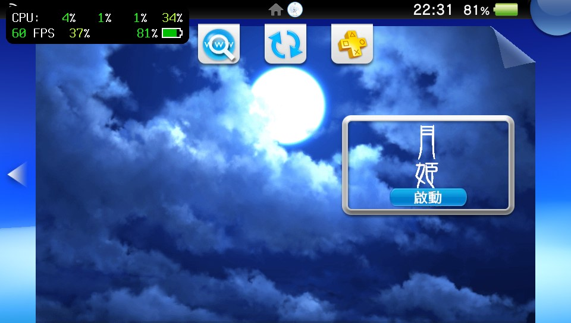
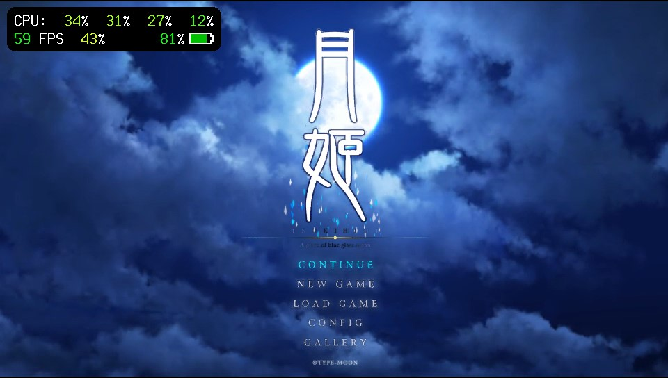
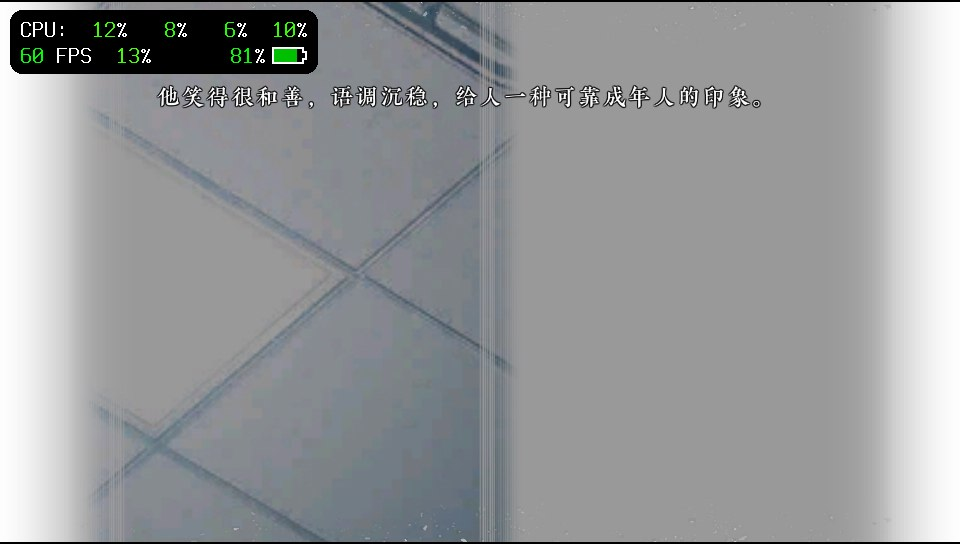

# tsik-vita · 月姬 PS Vita 移植版

将《月姬 -A piece of blue glass moon-》带到 **PlayStation Vita**。

本项目以 `mofa-vita` 的 Vita 移植实现为工程基准，基于 [AuroraWright/knife](https://github.com/AuroraWright/knife) 0.9.4 重实现引擎，使用 Rust 游戏逻辑与原生 GXM 图形后端，针对月姬 Switch 海外版适配素材、界面、字体与存档。游戏画面按 **960 × 540** 渲染，在 Vita 的 **960 × 544** 屏幕上显示。

**当前版本：2026-10-31，R3 双语言版 + 音乐／CG 画廊修复。** 项目已有玩家实机运行记录；本次音乐列表与 CG 缩略图修复已完成宿主回归测试、Vita ARM 构建和 VPK 检查，仍待实机复测。全路线通关、长时间稳定性及与 `mofa-vita` 全部特性的逐项设备验收尚未完成。

## 项目截图

以下均为玩家提供的 **PS Vita 实机截图**，拍摄于 2026-10-31。截图保留了设备监控叠层，显示的帧率仅代表对应场景。

### 主界面气泡与 LiveArea

| 主界面气泡 | LiveArea 启动画面 |
| --- | --- |
|  |  |

### 游戏标题与中文剧情

| 标题画面 | 简体中文剧情 |
| --- | --- |
|  |  |

`项目截图/` 中另两张音乐与 CG 界面图片记录了修复前的问题，未作为当前修复效果的展示图。欢迎在实机复测后补充新版画廊截图。

## 当前特性

- **简体中文与日文双语言**：设置中仅保留“简体中文／日本語”两个选项，新配置默认简体中文，切换后保存选择。旧配置中的英文、繁体中文等无效语言值迁移为简体中文。
- **统一主字体**：两种语言的剧情、动态界面、回看与气泡文字共用项目提供的 `arshanghaisonggbpro_lt.otf`；另保留“嗞、觍”两个补充字形及游戏特殊符号字体。原本绘制在图片中的文字按对应美术资源显示。
- **剧情与菜单**：包含剧情推进、选项、系统设置、存读档、快速存读档、自动播放、快进及回看等实现。
- **鉴赏功能**：包含 CG Gallery、Music Player、Flowchart、Movie 和 Ending List；内容按游戏进度与解锁条件开放。
- **Vita 输入与输出**：适配实体按键、双摇杆、前触摸屏，以及 Vita 原生音频和影片播放路径。
- **启动致谢画面**：每次启动先显示项目致谢图，淡入、停留、淡出合计约 5 秒，可按确认或触摸提前继续，随后进入原有启动流程。
- **统一数据目录**：素材、存档、配置、着色器缓存与资源错误记录集中于 `ux0:data/TSUKIHIME-RE/`。
- **外置 540p 素材**：使用预转换纹理、素材清单及图集／流资源索引，启动时检查关键文件与版本是否匹配。

以上列出当前实现范围，具体设备验证状态见[验证记录与已知限制](#验证记录与已知限制)。

## 安装

### 需要准备

1. 可安装和运行自制软件的 PS Vita，以及用于安装 VPK、传输文件的 VitaShell 等工具。
2. 引擎安装包：`knife-vita-tsukihime-540p.vpk`，由维护者另行发布，源码仓库不附带 VPK。
3. 与该引擎配套的完整转换素材：本地目录为 `dist/TSUKIHIME-RE/assets/`，约 **3.62 GiB**。

VPK 与游戏素材分开存放，**只安装 VPK 无法进入游戏**。运行需要使用者自行准备的游戏数据经本项目工具链转换；当前素材针对 **Switch 海外版合并 v1.0.1**，对应程序 build ID 为 `d10d239aade1d526`。原始 NSP 或未经转换的 romfs 不能直接放进 `assets/` 使用。

### 首次安装

1. 用 VitaShell 安装 `release/knife-vita-tsukihime-540p.vpk`。
2. 将 `dist/TSUKIHIME-RE/` 中的 `assets/` 整体传到 `ux0:data/TSUKIHIME-RE/assets/`。注意避免多套一层 `assets/assets/`。
3. 从 LiveArea 启动游戏。首次启动会检查关键素材，存档与缓存目录由程序创建。
4. 默认使用简体中文，需要日文时在游戏设置中切换。

正确的设备目录结构：

```text
ux0:data/TSUKIHIME-RE/
├── assets/
│   ├── vita-540p-assets.json
│   ├── language-profile.txt
│   ├── fonts/
│   ├── parts.hed
│   ├── parts.mrg
│   ├── w_allpac.hed
│   ├── w_allpac.nam
│   ├── w_allpac.mrg
│   └── …其余配套素材
├── saves/                  # 存档与游戏进度
├── shader-cache/           # 游戏自动生成的着色器缓存
└── resource-error.json     # 发生资源读取错误时才生成
```

其他运行配置与性能配置也位于 `TSUKIHIME-RE/` 下；没有对应文件时无需手动创建。

### 从旧版升级

升级前退出游戏，保留 `saves/` 与已有配置。根据已安装版本选择更新范围：

| 已安装的内容 | 更新方式 |
| --- | --- |
| 已使用当前 `TSUKIHIME-RE` 双语言素材，且包含启动致谢图 | 安装新版 VPK 即可。本次音乐／CG 修复没有修改素材。 |
| 已使用 R3 双语言素材，但尚未加入启动致谢图 | 安装新版 VPK，并从当前 `dist/TSUKIHIME-RE/assets/` 覆盖 `parts.hed`、`parts.mrg`、`vita-540p-assets.json` 三个文件。 |
| R2 或更早的四语言／旧字体素材，或无法确认素材版本 | 安装新版 VPK，更新为当前完整配套 `assets/`；不要删除 `saves/`。 |

旧数据路径为 `ux0:data/knife-tsukihime-540p/` 时，退出游戏后将整个文件夹**重命名**为 `TSUKIHIME-RE`，其中素材、存档与配置一并保留。若新旧目录已经同时存在，先核对存档再合并，避免覆盖需要保留的进度。

旧缓存 `ux0:data/knife-vita/shader-cache/` 可移动到 `ux0:data/TSUKIHIME-RE/shader-cache/`；也可让游戏在新位置重新生成。旧 `knife-vita/` 目录为空后即可删除。

为节省空间，本地只保留一套 `dist/TSUKIHIME-RE/assets/`，`release/` 只存放 VPK。更新时直接覆盖需要替换的文件，无需再复制一份完整素材作中转。

## 操作说明

部分界面沿用原版的 A／B 等按键图标：**A 对应 Vita ×，B 对应 Vita ○，X 对应 Vita □，Y 对应 Vita △**。

| Vita 输入 | 月姬中的主要操作 |
| --- | --- |
| × | 确认、推进剧情；消息窗口隐藏时先恢复窗口 |
| ○ | 取消、返回；剧情中优先停止快进，否则隐藏／显示消息窗口 |
| □ | 打开回看日志，再按可关闭 |
| △ | 打开／关闭系统菜单，受当前剧情状态限制 |
| L | 剧情中切换自动播放；菜单中按当前界面切换页签或项目 |
| R | 剧情中切换快进；菜单中按当前界面切换页签或项目 |
| 方向键、右摇杆 | 菜单导航、选择；剧情中的方向键 ↑ 打开模式面板 |
| 左摇杆 | 列表滚动、CG 列表选择、流程图滚动等界面操作 |
| 前触摸屏 | 点击、拖动与手势操作；轻触剧情画面顶部可打开模式面板 |
| START | 影片鉴赏播放时跳过影片 |
| SELECT | CG 查看时切换为铺满画面 |

**快速保存／快速读取通过剧情模式面板中的 Q.SAVE／Q.LOAD 操作**，也可使用系统菜单的存读档功能。START／SELECT 直接快存快读是参考项目《魔法使之夜》的专用逻辑，不适用于本项目月姬剧情界面。具体操作还会受选项、演出、存档许可与已有快存状态影响。

## 本版修复

### Music Player 列表文字与数值不显示

双语言素材中的补充字体仅包含两个字形，旧系统界面却将它作为主字体，导致曲名、播放时间和音量数值缺字。现在系统界面按“主字体 → 补充字体”的顺序加载，与剧情文字使用同一主字体策略。

### CG Gallery 缩略图不显示

CG 缩略图整页在当前素材中采用单张 KIMG 保存，旧界面加载路径只接受 KATL／原版图集。现在可识别该整页图片，并保留原有逻辑尺寸与 `cg_thumb_all` 名称供界面定位缩略图。

这两项修复均已用当前日文／简体中文实际素材做宿主回归验证，并打入当前 VPK；**新版设备显示效果仍待复测**。修复不改动存档与鉴赏解锁条件，也不需要替换当前配套素材。

此前版本还修复了素材解码与边界检查、月姬素材索引绑定、双语言存档兼容等问题。详细历史见 [R2 资源修复记录](doc/10-resource-repair-r2.md)和 [R3 双语言与字体记录](doc/11-bilingual-ja-zc-r3.md)。

## 发布包与素材识别

以下信息对应 **2026-10-31 当前本地交付物**，用于排查混包与复制错误。

| 项目 | 当前值 |
| --- | --- |
| VPK | `release/knife-vita-tsukihime-540p.vpk` |
| VPK 大小 | **7,050,294 字节**，约 6.72 MiB |
| 构建标识 | `tsukihime540-r3-gallery-fix-20261031` |
| TITLE ID / APP_VER | `KNIF00541` / `00.01` |
| 素材目录 | `dist/TSUKIHIME-RE/assets/` |
| 素材数量 | 16,764 个数据文件，另加 `vita-540p-assets.json` 清单 |
| 清单大小 | 2,736,748 字节 |
| 语言 | `ja` / `zc`；保留原始语言 ID 0 / 2 |
| 素材 schema | `knife-540p-assets-v1` |
| 素材 method | `native-540p-encoded-unorm-v2` |
| 色彩约定 / codec | `encoded-unorm8-v1` / 1、2、7、9 |

VPK 的 SHA-256：

```text
793aacf00773f3e4550826bf7d040eb1ccdb1e8de8b07c38098c954dc35450b2
```

当前 `vita-540p-assets.json` 的 SHA-256：

```text
f4589612a4f59119133dc54f0c34948757917c58ac0fda6e271dc26421f82a00
```

引擎内嵌的关键文件校验、图集索引与流资源索引和该清单配套。修改素材后需要重新生成相应元数据并构建 VPK；不要通过手改清单来绕过校验。

## 常见问题

| 现象或错误 | 检查与处理 |
| --- | --- |
| 启动显示 `ASSETS REQUIRED` / `MISSING FILE OR FOLDER` | 检查 `ux0:data/TSUKIHIME-RE/assets/` 是否存在、目录是否套错层，以及素材清单是否完整。 |
| `WRONG FILE SIZE` | 某个文件复制不完整或混用了旧文件。按错误屏提示核对并重新传输对应配套文件。 |
| `WRONG ASSET VERSION` | 文件内容与当前 VPK 的素材校验不一致。核对 VPK、清单和升级范围，使用同一版本的素材。 |
| `FILE READ FAILED` | 检查文件是否可读、传输是否完整以及存储设备状态。 |
| `ENGINE PROFILE ERROR` | 引擎内嵌校验资料有误，需要重新生成 profile 并构建。 |
| 游戏中提示素材损坏或无法继续 | 保留 `ux0:data/TSUKIHIME-RE/resource-error.json`（如有生成），记录语言、剧情位置、触发步骤与截图，便于定位具体资源。 |
| 更新后音乐列表／CG 仍为空 | 先确认安装的是本页 SHA-256 对应 VPK；再核对素材版本与存档解锁状态，并保留新版实机截图反馈。 |

排查显示或素材问题时请保留存档；清空进度会改变鉴赏内容的解锁状态。

## 开发与构建

### 工具链

- Linux／macOS，或 Windows + WSL。
- Python **3.9+**、CMake **3.20+**、Ninja、Bash、Git。
- VitaSDK，包含 ARM 编译器、newlib、Vita stubs 和 VPK 打包工具。
- Vita 交叉构建使用脚本固定的 **`nightly-2026-05-28`** 与 `rust-src`，目标为 `armv7-sony-vita-newlibeabihf`。
- `knife/rust-toolchain.toml` 的 **1.99.0** 用于宿主工具／测试，与交叉构建脚本的 nightly 分开。

公开源码仓库不上传游戏素材、VPK、构建缓存、下载的工具程序及专有运行时模块。构建前需自行准备 `libshacccg.suprx`，放到 `knife/vita/vendor/shacccg/libshacccg.suprx`；当前构建脚本校验的 SHA-256 为：

```text
0c58b5d3e1cc47d9837b8c59ab6f3c299bfe7adf55a83f547d553f9fbb776552
```

该文件仅在本地使用，已由 `.gitignore` 排除。素材转换使用的外部工具也需按[素材流水线说明](doc/04-asset-pipeline-plan.md)自行准备。

从项目根目录执行：

```bash
# 只读检查构建环境
python3 tools/build-vita.py --check

# 构建月姬 540p 正式 VPK
python3 tools/build-vita.py --variant tsukihime540 game release

# 检查正式安装包
python3 tools/check-vita-package.py release/knife-vita-tsukihime-540p.vpk KNIF00541 --release
```

Windows PowerShell 对应入口：

```powershell
py -3 tools/build-vita.py --check
py -3 tools/build-vita.py --variant tsukihime540 game release
py -3 tools/check-vita-package.py release/knife-vita-tsukihime-540p.vpk KNIF00541 --release
```

Windows 构建入口会探测 WSL；本地已验证环境为 `pocket-ubuntu`，VitaSDK 位于 `/opt/vitasdk`。工具链准备完成后，可设置 `KNIFE_VITA_OFFLINE=1` 禁止构建入口自动下载工具链。

正式构建启用 `vita-gxm,assets-540p,tsukihime`，`ATTRIBUTE2=12`。VPK 输出至 `release/`；日志、构建收据与中间产物位于 `.work/`。仅修改 README 或引用现有截图不需要重新构建 VPK。

素材发生变化时，需要根据变化范围运行 [profile 生成器](tools/generate_vita_asset_profile_tsukihime_540.py)、[图集索引生成器](tools/generate-vita-atlas-index.py)或[流资源索引生成器](tools/generate-vita-stream-index.py)，再构建匹配的 VPK。完整转换背景见[素材流水线说明](doc/04-asset-pipeline-plan.md)。

## 验证记录与已知限制

当前画廊修复的验证记录：

| 验证项目 | 已记录的结果与边界 |
| --- | --- |
| 实际素材回归 | 日文、简体中文曲名及数字面板所需字形可解析；两种语言 CG 整页可按原逻辑尺寸绑定。 |
| 宿主测试 | 125 项通过：双语言／存档／画廊／启动相关探针 58 项，Vita 平台测试 67 项。 |
| Vita ARM 正式构建 | 成功，当前 VPK 已包含上述修复。 |
| VPK 检查 | 包结构、21 个归档条目 CRC／哈希检查通过；包内 5 个 `sce_sys` 文件与当前项目资源一致。 |
| 实机证据 | 本页截图展示已有版本的启动、标题与中文剧情；最新音乐／CG 修复尚无复测截图。 |

尚待验证的范围包括全路线通关、旧素材阻断位置的持续回归、影片与音频的全内容兼容，以及长时间游玩的内存与性能表现。采用 `mofa-vita` 作为移植基准，不代表已经完成月姬全部场景的实机验收；参考项目的帧率与稳定性数据也不能直接作为本项目的测量结果。

## 目录与技术文档

| 路径 | 用途 |
| --- | --- |
| `knife/` | Rust 引擎工作区、原生 GXM 后端与 Vita 依赖 |
| `tools/` | 构建、包检查、素材转换与元数据生成工具 |
| `tools/probes/tsukihime-bilingual/` | 双语言、字体、CG 与启动素材等回归探针 |
| `dist/TSUKIHIME-RE/assets/` | 本机保留的当前完整转换素材 |
| `release/` | 当前 VPK |
| `项目截图/` | 玩家提供的实机截图，README 直接引用原文件 |
| `doc/` | 移植说明、历史审计与修复记录 |
| `.work/` | 本地日志、构建收据与可清理的中间产物 |

可进一步阅读：

- [移植流程与 mofa-vita 基准](doc/00-porting-process.md)
- [Switch 数据与程序版本核对](doc/01-nsp-inventory.md)
- [引擎适配说明](doc/02-engine-port-plan.md)
- [构建环境记录](doc/03-build-env.md)
- [素材转换流水线](doc/04-asset-pipeline-plan.md)
- [mofa-vita 特性对照审计（修复前记录）](doc/09-mofa-parity-audit.md)
- [R2 资源修复记录](doc/10-resource-repair-r2.md)
- [R3 双语言与字体记录](doc/11-bilingual-ja-zc-r3.md)
- [完整文档索引](doc/README.md)

历史文档中的包大小、哈希、旧目录与阶段性结论仅对应当时版本；当前安装路径和交付物以本 README 为准。`doc/` 中从 `mofa-vita` 继承的参考文档，其游戏身份与历史实测数据仍属于《魔法使之夜》。

## 致谢与许可

感谢 **@Zarathustra**、**@listen** 长期为本项目付出的时间与努力，感谢每一位支持者，以及提供实机测试、截图和问题反馈的玩家。

感谢 [AuroraWright/knife](https://github.com/AuroraWright/knife) 提供引擎重实现基础，感谢 `mofa-vita` 提供经过实机实践的 Vita 移植基准，感谢 VitaSDK、SceShaccCgExt 及相关开源依赖的贡献者。

引擎沿用上游 [Mozilla Public License 2.0](knife/LICENSE)。SceShaccCgExt 与其他依赖各自适用其许可，相关声明见项目依赖目录与 VPK 内的 `licenses/`，发布时应保留。游戏名称、美术、剧本、音视频、字体及转换素材的权利归各自权利方；引擎开源许可不改变这些资源的权利归属。
